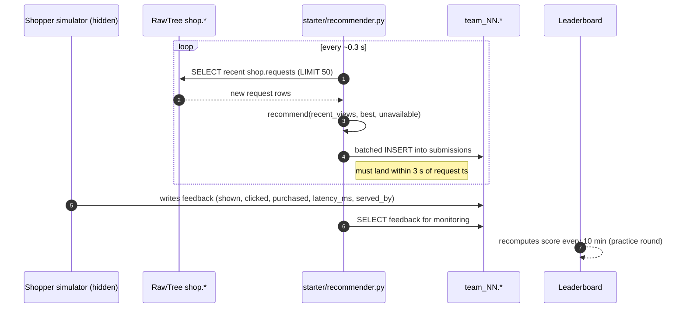

# Build & Test Workflow

A step-by-step map for the RawTree recommendation challenge: **setup → offline eval → build → deploy → validate live → read leaderboard → freeze for the final round.**

> TL;DR: fill `.env` → open `starter/offline_eval.ipynb` and get baseline metrics → change `recommend()` in `starter/recommender.py` → re-run the notebook until you beat baseline → run `python starter/recommender.py` → check `team_NN.feedback` → check the leaderboard page.

**Reality check on file names**

- There is **no `offline_eval.py`**. The offline harness is `starter/offline_eval.ipynb` (a Jupyter notebook).
- The only runnable Python entry point is `starter/recommender.py`.
- `starter/queries.sql` is a copy-paste library of SQL checks, not a script.

---

## 1. End-to-end map

```mermaid
flowchart TD
    START(["Start / new teammate"]) --> CRED

    subgraph P0["Phase 0 - Setup (once)"]
        CRED["Get TEAM_ID + RAWTREE_API_KEY<br/>at the RawTree stand"]
        ENV["cp .env.example .env<br/>TEAM_ID=team_NN<br/>RAWTREE_API_KEY=rt_..."]
        DEPS["pip install -r starter/requirements.txt"]
        PING["Verify access:<br/>SELECT count() FROM shop.catalog"]
        CRED --> ENV --> DEPS --> PING
    end

    PING --> Q

    subgraph P1["Phase 1 - Explore + baseline metrics (works before stream opens)"]
        Q["Study the data with starter/queries.sql<br/>shop.catalog · history_sessions · history_events"]
        NB["Open starter/offline_eval.ipynb<br/>reads ../.env, imports recommender.py"]
        RUN["Run all cells top to bottom:<br/>1. hold out last 7 days (CUT)<br/>2. best = best_sellers(until=CUT)<br/>3. co-views from history_events<br/>4. evaluate baseline + coview"]
        METRICS["Record baseline:<br/>hit_rate@10 · IPS/SNIPS slot-1 CTR · slot1_matches"]
        Q --> NB --> RUN --> METRICS
    end

    METRICS --> IDEA

    subgraph P2["Phase 2 - Build a candidate (fast offline loop)"]
        IDEA["Pick one idea:<br/>co-views · matrix factorisation · trends · price · cold start"]
        CODE["Edit recommend() in starter/recommender.py<br/>keep the pull -> predict -> push contract"]
        RERUN["Re-run the import cell -> Policies cell -> Evaluation cell<br/>(it imports the live code, so you test what ships)"]
        GATE{"Gate: beats baseline?<br/>hit_rate@10 up AND SNIPS up<br/>and slot1_matches not tiny"}
        IDEA --> CODE --> RERUN --> GATE
        GATE -- "No" --> IDEA
    end

    GATE -- "Yes" --> STOP

    subgraph P3["Phase 3 - Deploy live (after Sat 10:00 CET)"]
        STOP["Stop any old recommender process<br/>run exactly ONE instance per team"]
        LAUNCH["python starter/recommender.py<br/>from the repo root<br/>keep alive: tmux / nohup / systemd"]
        LOGS["Watch stdout:<br/>'answered N' = healthy<br/>'error: ...' = retrying, investigate"]
        STOP --> LAUNCH --> LOGS
    end

    LOGS --> SUB

    subgraph P4["Phase 4 - Validate on live data + leaderboard"]
        SUB["Check team_NN.submissions:<br/>1 row per request, 10 distinct active IDs"]
        FB["Check team_NN.feedback:<br/>served_by=team %, fallback_reason, p50/p95 latency"]
        LB["Open datathon.rawtree.dev/leaderboard<br/>wait for the next 10-minute refresh"]
        DECIDE{"Reliability ~99%+?<br/>score above baseline / reference?"}
        FIX["Fix invalid IDs, latency or exceptions<br/>then redeploy"]
        SUB --> FB --> LB --> DECIDE
        DECIDE -- "No" --> FIX --> STOP
    end

    DECIDE -- "Yes" --> ITER

    subgraph P5["Phase 5 - Iterate, then freeze"]
        ITER["Keep reading feedback + live trends"]
        FREEZE["Before Sun 10:00 CET:<br/>best version running and supervised"]
        FINAL["Sun 10:00-12:00: leaderboard dark<br/>watch the status light stay green<br/>(>90% valid and on time, last 5 min)"]
        RANK["Sun 12:00: final ranking appears automatically"]
        ITER --> FREEZE --> FINAL --> RANK
    end

    ITER -. "try an improvement" .-> IDEA
```



---

## 2. What runs when (runtime picture)



---

## 3. Step by step

### Step 0 — Setup (once)

```bash
cd /usr/tests/datathon-fme-2026
cp .env.example .env          # fill TEAM_ID=team_NN and RAWTREE_API_KEY=rt_...
pip install -r starter/requirements.txt
```

Verify RawTree access:

```bash
set -a; . ./.env; set +a
curl -s https://api.rawtree.com/v1/query \
  -H "Authorization: Bearer $RAWTREE_API_KEY" \
  -H "Content-Type: application/json" \
  -d '{"sql":"SELECT count() AS n FROM shop.catalog"}'
```

> **Path rule:** `recommender.py` reads `.env` from the current directory, and the notebook reads `../.env`. Run the recommender **from the repo root**; open the notebook **from `starter/`** (Jupyter does this for you).

### Step 1 — Offline baseline (before you write any model)

```bash
pipx run $(sed 's/^/--with /' starter/requirements.txt | tr '\n' ' ') \
  jupyter notebook starter/offline_eval.ipynb
```

Run all cells in order. They will:

1. Query the last 7 days of `shop.history_sessions` as the held-out test set.
2. Import `best_sellers` and `recommend` from `starter/recommender.py` and build `best = best_sellers(until=CUT)` (no test-period leakage).
3. Build a co-view table from `shop.history_events` (train data only).
4. Print `hit_rate@10`, `IPS_ctr_slot1`, `SNIPS_ctr_slot1`, `slot1_matches` for `baseline` and `coview`.

**Write down the baseline row.** That is your bar for every later change.

### Step 2 — Build and re-test (the loop you repeat most)

- Implement your policy in `recommend(recent_views, best, unavailable) -> list[str]` inside `starter/recommender.py`.
- Add it to the `POLICIES` dict in the notebook's **Policies** cell, e.g. `POLICIES["mine"] = my_policy`.
- Re-run the **import** cell → **Policies** cell → **Evaluation** cell (the later cells depend on `best`, `covisit` and `test`). Because the notebook imports the live module, the numbers you see are the code you will deploy.

**Gate before deploying:** `hit_rate@10` and `SNIPS_ctr_slot1` both beat baseline, and `slot1_matches` is not so small that the IPS estimate is noise.

### Step 3 — Deploy live

Only after the stream opens (Saturday 10:00 CET) will answers reach the leaderboard. Before that, `shop.requests` is empty and queries fail with *Unknown expression identifier* — that is expected, the baseline just retries. You can start the process early to confirm it stays alive; it will begin answering on its own when the stream opens.

```bash
# stop any old instance first - one per team
pkill -f starter/recommender.py

# from the repo root
nohup python starter/recommender.py > recommender.log 2>&1 &
tail -f recommender.log
```

Healthy log: repeated `answered N`. Unhealthy: repeated `error: ...`.

### Step 4 — Verify the live pipeline

Replace `team_NN` with your `TEAM_ID` in these queries.

**Are submissions landing?**

```sql
SELECT count() AS n_rows, uniqExact(request_id) AS n_requests
FROM team_NN.submissions;
```

**Bad rows (wrong length / duplicates):**

```sql
SELECT request_id, length(items) AS n, uniqExact(arrayJoin(items)) AS distinct_n
FROM team_NN.submissions
GROUP BY request_id
HAVING n != 10 OR distinct_n != 10
LIMIT 20;
```

**Conversion and who served the shopper** (from `starter/queries.sql` #5):

```sql
SELECT served_by::String AS served_by,
       count() AS requests,
       100 * countIf(clicked != '') / count()   AS ctr_pct,
       100 * countIf(purchased != '') / count() AS conversion_pct,
       sum(revenue_eur::Float64) / count()      AS revenue_per_request
FROM team_NN.feedback
WHERE request_id != '__init__' AND ts > now() - INTERVAL 30 MINUTE
GROUP BY served_by;
```

**Reliability / latency / fallback reasons** (`starter/queries.sql` #6):

```sql
SELECT fallback_reason::String             AS fallback_reason,
       count()                             AS requests,
       quantile(0.5)(latency_ms::Float64)  AS p50_ms,
       quantile(0.95)(latency_ms::Float64) AS p95_ms
FROM team_NN.feedback
WHERE ts > now() - INTERVAL 30 MINUTE AND request_id != '__init__'
GROUP BY fallback_reason;
```

How to read it:

| Symptom | Meaning | Fix |
|---|---|---|
| `served_by = fallback`, reason `missing` | Request never answered | Process down / poll too slow / crash loop |
| reason `late` | Arrived after 3 s | Too slow: cache, batch, less work per request |
| reason `invalid` | Not 10 distinct active IDs | Filter duplicates, out-of-stock, inactive; pad to 10 |
| `p95_ms` near 3000 | On the edge | Optimise before the next deploy |

### Step 5 — Check the leaderboard

Open <https://datathon.rawtree.dev/leaderboard>.

- **Saturday 10:00 → Sunday 10:00 (practice):** public board, refreshed every **10 minutes**. Use it to confirm your feedback queries match reality; it does **not** count for the final 70 points.
- **Sunday 10:00 → 12:00 (final):** board hidden; only a **green/red light** per team (green = >90% valid and on-time answers in the last 5 min). Watch it, not the score.
- **Sunday 12:00:** final ranking appears automatically. Nothing to submit — the running system *is* the submission.

Do not chase 10-minute noise. Compare trends over hours, and cross-check the board against the `feedback` conversion query above (the board scores expected purchases, so they should track).

### Step 6 — Freeze

Before Sunday 10:00 CET:

- Best version running, supervised, on a machine that will not sleep.
- `.env` present, single instance, logs rotating or at least being watched.
- No risky deploys during the final round. A broken process at 10:05 shows red immediately.

---

## 4. Command cheat sheet

| I want to... | Do this |
|---|---|
| Install deps | `pip install -r starter/requirements.txt` |
| Open offline eval | `pipx run $(sed 's/^/--with /' starter/requirements.txt \| tr '\n' ' ') jupyter notebook starter/offline_eval.ipynb` |
| Run the live recommender | `python starter/recommender.py` (repo root) |
| Run without global install | `uv run --with requests python starter/recommender.py` |
| Query RawTree from the CLI | `rtree query --api-key $RAWTREE_API_KEY --database $TEAM_ID "<sql>"` |
| Inspect my answers | `SELECT * FROM team_NN.submissions LIMIT 5` |
| Inspect outcomes | `SELECT * FROM team_NN.feedback WHERE request_id != '__init__' LIMIT 5` |
| See the ranking | <https://datathon.rawtree.dev/leaderboard> |
| Reference SQL | `starter/queries.sql` (checks 5 and 6 are your live dashboard) |

---

## 5. Common traps

- **Running `recommender.py` from inside `starter/`** → `.env` is not found → `KeyError: 'TEAM_ID'`. Run from repo root.
- **Two recommender instances** → duplicated answers and wasted requests. Kill the old one first.
- **Answering before the stream opens** → expected `Unknown expression identifier`; it is not a bug.
- **Returning fewer than 10 items** → whole answer is invalid → fallback → reliability points lost.
- **Recommending an out-of-stock product** → whole answer is invalid. Use the `OUT_OF_STOCK` query logic already in `recommender.py`.
- **Tuning on the test split** → the notebook holds out the last 7 days for a reason; don't build features from it.
- **Believing a single 10-minute leaderboard jump** → check `feedback` over a longer window first.
